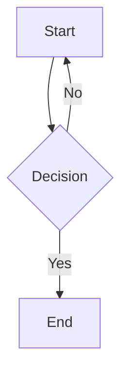

# Obsidian Syntax Test

One example per row of the compatibility audit. Edit a block, save, and
re-open to see what round-trips vs. what degrades.

## 1. CommonMark basics

**bold**, *italic*, __bold__, _italic_

### ATX heading

Setext H1
=========

Setext H2
---------

- dash bullet
* star bullet
+ plus bullet

1. one
2. two

5) five, custom start, paren delimiter
6) six

- top
  1. nested ordered
  2. nested ordered
  - nested bullet

> top-level quote
> > nested quote
> > > triple-nested quote

Inline `code` and a fenced block:

```js
const x = 1;
```

    indented code block
    second line

***

---

___

- - -

[link with title](https://example.com "a title")

See [the reference link][ref1] for details.

[ref1]: https://example.com/reference "reference title"

Autolink: <https://example.com/autolink>


Hard break via two trailing spaces:  
next line.

Hard break via backslash:\
next line.

Escaped: \*not italic\*, \_not italic\_, \[not a link\]

Raw inline HTML: <u>underline</u> and a line break<br>after it.

Entities: &amp; &copy; &lt; &gt;

## 2. GitHub Flavored Markdown

- [ ] unchecked task
- [x] checked task

| Left | Center | Right |
|:---|:---:|---:|
| a | b | c |
| d | e | f |

Bare URL: https://example.com/bare

Footnote reference[^1] in a sentence.

[^1]: Footnote definition text.

## 3. LaTeX / math

Inline math: $E = mc^2$

Block math:

$$
\int_0^1 x^2 \, dx = \frac{1}{3}
$$

LaTeX environment:

$$
\begin{align}
a &= b + c \\
d &= e + f
\end{align}
$$

## 4. Obsidian-only syntax

==highlighted text==

%% this is a hidden comment, should not render %%

Visible text around a %%inline comment%% comment.

[[Block Showcase]]

[[Block Showcase|Display Text]]

[[Block Showcase#Some Heading]]

[[#Some Heading In This Doc]]

[[Block Showcase#^block-id-123]]

[[#^local-block-id]]

![[Block Showcase]]

![[Block Showcase#Some Heading]]

![[image.png|200]]

![[Doc.pdf#page=3]]

```query
tag:#test
```



Inline tag: #test and a nested tag: #project/plexus

> [!note]
> A standard note callout.

> [!tip] Custom Title Here
> A tip callout with a custom title after the type.

> [!warning]-
> A foldable (collapsed by default) warning callout.

> [!abstract]
> A callout type outside Plexus's supported 5 (abstract/todo/success/
> question/failure/bug/example/quote).

> [!note]
> > [!tip]
> > A nested callout inside another callout.
